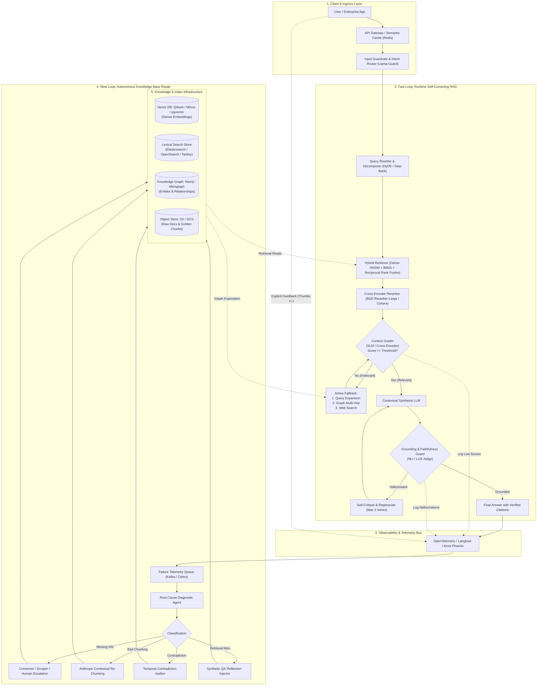
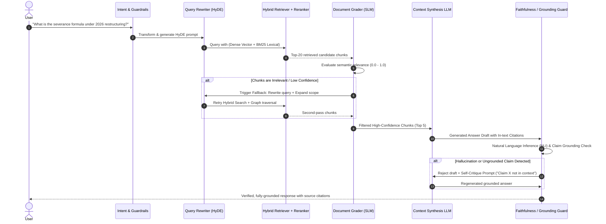
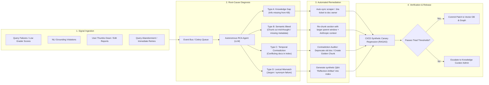
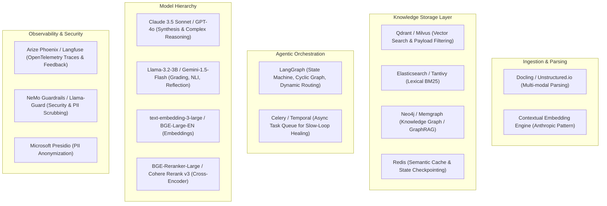

# Enterprise Self-Healing RAG Knowledge Base: Architectural Blueprint & Production Plan

## Executive Summary

Traditional Retrieval-Augmented Generation (RAG) architectures operate as **open-loop, linear pipelines** (`Query → Embed → Vector Search → Generate`). In real-world enterprise deployments, open-loop RAG breaks down due to silent retrieval degradation: noisy chunks, semantic bleed, outdated/conflicting documentation, and hallucinated generations.

A **Self-Healing RAG Knowledge Base** transforms linear RAG into a **resilient, dual-loop closed-loop system**:
1. **The Fast Loop (Runtime Query-Time Healing):** Real-time evaluation of retrieval quality, dynamic query reformulation, multi-strategy fallback (hybrid + GraphRAG + web search), and post-generation hallucination critique before returning results to users.
2. **The Slow Loop (Asynchronous Knowledge-Base Self-Curation):** Continuous audit of the knowledge base itself. Using failure telemetry (low confidence scores, hallucination flags, negative user feedback), an autonomous diagnostic agent detects missing knowledge, resolves cross-document contradictions, rewrites low-performing chunks, and dynamically patches the index.

```
+===================================================================================================+
|                                    THE DUAL-LOOP ARCHITECTURE                                     |
+===================================================================================================+
                                                                                                     
    FAST LOOP: Real-Time Query Self-Correction (Latency budget: 800ms - 2.5s)                        
    +-----------------------------------------------------------------------------------------+     
    | [User Query]                                                                            |     
    |      |                                                                                  |     
    |      v                                                                                  |     
    | [Query Transformation] ---> [Hybrid Retrieval] ---> [Document Grader]                   |     
    |    (Decompose/HyDE)            (Dense + BM25)              |                            |     
    |                                                            |--- [Irrelevant] -> [Rewrite]     
    |                                                            v                            |     
    | [Answer Grounding Check] <-- [Context Synthesis] <--- [Relevant Chunks]                 |     
    |         |                                                                               |     
    |         +--- [Hallucination Detected] ---> [Regenerate with Negative Constraints]       |     
    |         v                                                                               |     
    |   [Verified Output]                                                                     |     
    +-----------------------------------------------------------------------------------------+     
           |                                                                                        
           | Traces, Failed Retrievals, Grounding Errors, User Downvotes                            
           v                                                                                        
    SLOW LOOP: Autonomous Knowledge Base Repair (Async Cron / Event Queue)                          
    +-----------------------------------------------------------------------------------------+     
    | [Failure Telemetry Store] (Phoenix / Langfuse / OTel)                                   |     
    |      |                                                                                  |     
    |      v                                                                                  |     
    | [Root-Cause Diagnostic Agent]                                                           |     
    |      |                                                                                  |     
    |      +---> Knowledge Gap? ---------> [Trigger Web/API Ingestion or Human Ticket]        |     
    |      +---> Semantic Bleed? --------> [Contextual Re-Chunking & Parent Expansion]        |     
    |      +---> Fact Contradiction? ----> [Cross-Doc Temporal Conflict Auditor & Diff Tool]  |     
    |      +---> Poor Recall? -----------> [Generate Synthetic Q&A "Reflection Artifacts"]   |     
    |      |                                                                                  |     
    |      v                                                                                  |     
    | [Index Auto-Patch & Re-Embedding] ---> [CI/CD Synthetic Canary Regression (RAGAS)]      |     
    +-----------------------------------------------------------------------------------------+     
```

---

## 1. High-Level System Architecture



---

## 2. Deep-Dive: Pillar by Pillar

### Pillar 1: Ingestion & Knowledge Representation

A self-healing system cannot heal bad data if the initial ingestion is opaque or uncontextualized.

#### 1. Multi-Modal Parsing & Structural Extraction
* **Tools:** `Docling` or `Unstructured.io`.
* **Requirements:**
  * Preserve Markdown table formatting, equations, hierarchical headers (`#`, `##`, `###`), and image captions.
  * Extract bounding boxes and page offsets to support exact citation highlighting in source documents.

#### 2. Anthropic Contextual Retrieval Pattern
* **The Failure Mode:** Splitting documents blindly into 500-token chunks strips surrounding context. For example, a chunk reading *"The penalty rate was increased to 5%"* loses the identity of the product, jurisdiction, or effective date.
* **The Solution:** During ingestion, invoke a high-throughput, cost-efficient LLM (e.g., Claude 3.5 Haiku, Gemini 1.5 Flash, or Llama 3.2 3B) to prepend a 50–100 token situational context to every chunk before indexing:
  $$\text{Indexed\_Chunk} = \text{Contextual\_Summary}(\text{Whole\_Doc}, \text{Chunk}) + "\n\n" + \text{Original\_Chunk}$$
* **Dual Indexing:** Generate both **Contextual Dense Embeddings** (e.g., `text-embedding-3-large` or `bge-large-en-v1.5`) and **Contextual BM25 Lexical Tokens**.

#### 3. Parent-Child / Hierarchical Chunking
* **Index Representation:** Store small leaf chunks (150–300 tokens) in the vector index for high-precision retrieval matching.
* **Generation Context:** When a leaf chunk matches, retrieve its parent section or enclosing document window (1,000–2,000 tokens) for LLM synthesis.

#### 4. Dual Representation: Vector + Knowledge Graph (GraphRAG)
* Extract triples `(Subject, Predicate, Object)` and community summaries using LightRAG or Microsoft GraphRAG.
* Ingest entities into Neo4j/Memgraph. This enables cross-document reasoning (e.g., *"Which subsidiaries are affected by Policy X updated in Q3?"*).

---

### Pillar 2: The Fast Loop (Runtime Query-Time Healing)

The Fast Loop guarantees that no unverified or irrelevant context reaches the user.



#### Detailed Fast-Loop Mechanisms

1. **Query Transformation & Decomposition**:
   * **Sub-Query Decomposition:** Break complex multi-part questions into discrete atomic queries executed in parallel.
   * **HyDE (Hypothetical Document Embeddings):** For abstract queries, generate a hypothetical ideal document chunk and embed that instead of the raw question.
   * **Step-Back Prompting:** Abstract the specific query to broad principles to retrieve foundational context.

2. **Hybrid Retrieval & Fusion**:
   * Combine Dense Vector Search (cosine similarity on HNSW index) with Sparse Lexical Search (BM25 with token matching).
   * **Reciprocal Rank Fusion (RRF):**
     $$RRF\_Score(d) = \sum_{m \in \{Dense, BM25\}} \frac{1}{k + \text{Rank}_m(d)}, \quad k = 60$$
   * Pass Top 30 RRF candidates to a Cross-Encoder Reranker (e.g., `bge-reranker-large` or `cohere-rerank-v3`) to output the top 7 precision-scored chunks.

3. **Corrective RAG (CRAG) Document Grader**:
   * A lightweight, sub-50ms evaluator (fine-tuned SLM or optimized prompt on Llama 3.2 3B / Gemini Flash) scores each chunk as **Relevant**, **Ambiguous**, or **Irrelevant**.
   * If $> 50\%$ of chunks are irrelevant, the system triggers active recovery:
     * *Ambiguous:* Web search fallback or Knowledge Graph entity traversal.
     * *Irrelevant:* Query rewrite and search filter widening.

4. **Self-RAG Reflection & Grounding Guard**:
   * Once the synthesis LLM generates an answer with citations `[1], [2]`, an automated **NLI (Natural Language Inference) Entailment Model** validates each statement:
     $$\text{Entailment}(Premise=\text{Retrieved\_Chunks}, Hypothesis=\text{Generated\_Statement})$$
   * If any claim is classified as *Contradiction* or *Neutral* (ungrounded), the generation is sent to a self-critique loop with instructions to drop the ungrounded claim.
   * Hard bounded to a maximum of 2 regeneration cycles to maintain strict latency SLAs.

---

### Pillar 3: The Slow Loop (Autonomous Knowledge-Base Healing)

This is the system's "immune system." Rather than treating retrieval failures as isolated incidents, the slow loop diagnoses the underlying cause and patches the knowledge base.



#### Detailed Slow-Loop Remediation Strategies

| Failure Type | Diagnostic Indicator | Self-Healing Action |
| :--- | :--- | :--- |
| **Type A: Knowledge Gap** | High query volume, retrieval confidence < 0.35, web fallback required. | Autonomous discovery: The system identifies missing subject entities. If connected to enterprise connectors (Confluence, Notion, SharePoint), triggers an immediate re-crawl. If external, files a structured request to content curators. |
| **Type B: Semantic Bleed** | Retrieved chunks contain partial sentences, missing table keys, or lack section context. | Re-chunking: The system retrieves the original source document, expands the parent boundary around the failed section, generates a new contextual prompt, and replaces the stale chunks in Qdrant. |
| **Type C: Temporal Contradiction** | Grounding check detects two retrieved chunks asserting contradictory facts (e.g., v1 policy vs v2 policy). | Contradiction Auditor: Compares document timestamps, metadata versions, and semantic assertions. Sets `metadata.valid_until = NOW()` on the obsolete document and creates a **Reconciliation Golden Chunk** with a clear changelog note. |
| **Type D: Semantic Blindspot** | User query uses colloquial terms/acronyms not present in formal documentation. | Reflection Artifact Injection: Generates 5–10 synthetic Q&A pairs capturing the user's vocabulary and links them directly to the target canonical document chunk. |

---

### Pillar 4: Production Evaluation & Continuous Quality Assurance

To prevent the knowledge base from degrading over time, all code and knowledge index updates pass through an automated evaluation harness.

#### 1. The RAG Triad Metrics (Evaluated via RAGAS / Phoenix / TruLens)

```
                       +-----------------------+
                       |      User Query       |
                       +-----------------------+
                        /                     \
       (1) Context Relevance                 (3) Answer Relevance
                      /                         \
                     v                           v
          +--------------------+        +--------------------+
          | Retrieved Contexts |=======>|  Generated Answer  |
          +--------------------+        +--------------------+
                    \                      /
                     \                    /
                   (2) Groundedness / Faithfulness
```

1. **Context Relevance (Retrieval Metric):** Are the retrieved chunks strictly pertinent to the query without extraneous noise?
2. **Groundedness / Faithfulness (Generation Metric):** Can every claim in the generated answer be directly inferred from the retrieved chunks?
3. **Answer Relevance (End-to-End Metric):** Does the generated response directly and completely satisfy the user's intent?
4. **Noise Sensitivity & Negative Rejection:** When presented with distracting or irrelevant context, does the model refuse to answer or filter the noise rather than hallucinating?

#### 2. Synthetic Test Harness & Canary Regression
* **Synthetic Dataset Generator:** Every week, an automated job samples 5% of documents across the knowledge base and generates realistic (Query, Context, Ground-Truth Answer) triplets.
* **CI/CD Quality Gates:** When a developer changes an embedding model, chunking algorithm, or system prompt—or when the autonomous self-healing agent patches $>100$ chunks—a GitHub Actions / GitLab CI runner executes the test suite.
* **Pass/Fail Thresholds:**
  * Faithfulness $\ge 0.92$
  * Answer Relevance $\ge 0.88$
  * Context Precision $\ge 0.85$
  * If scores fall below thresholds, the deployment/patch is rolled back automatically.

---

### Pillar 5: Technology Stack & Production Infrastructure



#### Detailed Production Stack Specifications

| Layer | Recommended Technology | Rationale |
| :--- | :--- | :--- |
| **Document Parser** | `Docling` (IBM) + `PyMuPDF` | Best-in-class open-source parsing of multi-column PDFs, tables, equations, and Markdown structure. |
| **Vector Database** | `Qdrant` | Native HNSW vector indexing, robust JSON payload filtering, multi-tenancy, and distributed scalability. |
| **Lexical Engine** | `Tantivy` or `Elasticsearch` | Ultra-fast BM25 lexical token matching for hybrid Reciprocal Rank Fusion. |
| **Knowledge Graph** | `Neo4j` or `Memgraph` | Native Cypher querying, graph entity linking, and high-performance multi-hop GraphRAG traversal. |
| **State Orchestration** | `LangGraph` | Built-in support for cyclic graphs, conditional routing, state persistence, human-in-the-loop, and time-travel debugging. |
| **Reranker** | `BAAI/bge-reranker-large` (Local) or `Cohere Rerank v3` (API) | Cross-encoder architecture providing superior precision compared to bi-encoder vector similarity alone. |
| **Evaluator SLM** | `Llama-3.2-3B` or `Gemini 1.5 Flash` | Sub-100ms inference time and low token cost for high-volume document grading and NLI checks. |
| **Observability** | `Arize Phoenix` + `Langfuse` | Full OpenTelemetry trace lineage: records query transformations, retrieved chunks, grading scores, and user feedback. |
| **Security & Privacy** | `Microsoft Presidio` + `Llama-Guard 3` | PII redaction at ingestion and real-time defense against prompt injection / jailbreak attempts. |

---

## 3. End-to-End Implementation Plan (8-Week Roadmap)

### Phase 1: Foundation & Baseline Pipeline (Weeks 1–2)
* [ ] **Sprint 1.1: Document Parsing & Metadata Architecture**
  * Set up `Docling` extraction pipeline for PDF, Word, HTML, and Markdown.
  * Standardize document metadata schema (`doc_id`, `version`, `author`, `department`, `created_at`, `valid_until`, `access_roles`).
* [ ] **Sprint 1.2: Hybrid Indexing & Anthropic Contextual Retrieval**
  * Implement contextual summary generation for every chunk using a fast LLM.
  * Ingest into Qdrant (dense vectors) and Elasticsearch/Tantivy (BM25 lexical).
  * Build Reciprocal Rank Fusion (RRF) and BGE-Reranker scoring module.

### Phase 2: Runtime Fast-Loop Self-Healing (Weeks 3–4)
* [ ] **Sprint 2.1: LangGraph State Machine Architecture**
  * Implement state schema: `query`, `sub_queries`, `documents`, `grader_scores`, `generation`, `retry_count`, `citations`.
  * Build the **Document Relevance Grader** node (binary/graded filter with latency budget $< 150$ms).
  * Build the **Query Reformulation Node** with HyDE and Step-Back fallback strategies.
* [ ] **Sprint 2.2: Grounding Guard & Hallucination Critique**
  * Integrate an NLI entailment check for claim-level verification against context chunks.
  * Implement bounded self-critique regeneration loop (max 2 retries, fallback to explicit disclaimer).

### Phase 3: Observability, Guardrails & Evaluation Harness (Weeks 5–6)
* [ ] **Sprint 3.1: OpenTelemetry Tracing & Feedback Ingress**
  * Instrument all LangGraph nodes with `Arize Phoenix` / `Langfuse`.
  * Build user feedback ingestion endpoints (thumbs up/down, user correction, citation clicks).
  * Configure alerts for queries with low confidence ($< 0.40$) or high retry counts ($> 1$).
* [ ] **Sprint 3.2: Automated Regression Suite (CI/CD)**
  * Generate a baseline synthetic golden dataset (300 QA pairs) using RAGAS.
  * Add automated GitHub Actions test harness validating Faithfulness, Context Precision, and Answer Relevance on every PR.

### Phase 4: Autonomous Slow-Loop Knowledge Base Repair (Weeks 7–8)
* [ ] **Sprint 4.1: Root-Cause Diagnostic Agent**
  * Deploy background worker (Celery/Temporal) consuming failed query traces.
  * Build classification logic for: *Knowledge Gap*, *Semantic Bleed*, *Temporal Contradiction*, and *Lexical Mismatch*.
* [ ] **Sprint 4.2: Automated Index Patching & Canary Release**
  * Implement automated re-chunking and synthetic Q&A reflection injection for detected gaps.
  * Build the **Temporal Contradiction Auditor** to flag and deprecate out-of-date documents.
  * Wire up the CI/CD canary gate: auto-patched chunks must pass synthetic regression before merging to the production index.

---

## 4. Key Failure Modes & Production Mitigation Strategies

| Failure Mode | Root Cause | Self-Healing Mitigation |
| :--- | :--- | :--- |
| **The Infinite Loop Trap** | Query rewriter continuously generates variations that fail grading. | State machine enforces a strict `MAX_RETRIES = 2`. On breach, immediately graceful-degrade: emit a transparent response explaining what was missing, or route to human support. |
| **Latency Creep (High TTFT)** | Multiple LLM calls for grading, rewriting, and reflection increase latency to 8–10 seconds. | 1. Use small, quantized SLMs (Llama-3.2-3B or Gemini Flash) for grading and NLI.<br>2. Run hybrid retrieval and grading concurrently where possible.<br>3. Implement Redis semantic caching for frequently asked queries (bypassing the loop entirely on cache hits). |
| **Poisoning the Knowledge Base** | Slow-loop automated patching generates hallucinated synthetic chunks that corrupt the index. | **Canary Gating:** Never push an auto-generated reflection chunk or re-chunked doc directly to production. All automated patches are pushed to a staging collection and evaluated against synthetic test suites. Chunks causing regressions are routed to human review. |
| **Cross-Document Contradiction** | Old version of policy contradicts new version; vector search retrieves both. | Temporal decay weighting in vector search + automated **Contradiction Auditor** that reads creation timestamps and version numbers, marking older documents as deprecated or archiving them. |
| **Prompt Injection via Knowledge Base** | Ingested PDF contains adversarial prompt instructions (indirect prompt injection). | Ingress sanitization via `Llama-Guard 3` and delimiter encapsulation with strict XML isolation tags (`<context>...</context>`) in the generation prompt. |

---

## 5. Summary & Next Steps

This architecture provides a complete roadmap for building a **Self-Healing RAG Knowledge Base** that starts with resilient ingestion, prevents hallucinations at runtime through closed-loop feedback, and autonomously maintains and repairs the underlying knowledge base over time.

### Recommended Immediate Actions:
1. **Repository Setup:** Initialize the folder structure and setup the virtual environment.
2. **Component Implementation:** Begin Phase 1 by implementing the multi-modal ingestion pipeline and Anthropic contextual retrieval chunker.
3. **Workflow Prototyping:** Build the foundational LangGraph state machine with document grading and hallucination critique.
